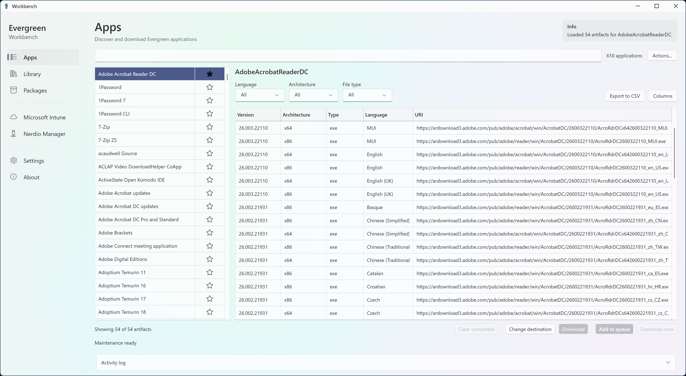

# Evergreen Workbench

A WPF-based graphical frontend and headless API for the [Evergreen](https://eucpilots.com/evergreen/) PowerShell module.

Evergreen Workbench ships as a separate PowerShell module so it never modifies
the core Evergreen module. The current preview is in `EvergreenUI\`, targets
Windows, and requires **PowerShell 7.6+**.



## Current implementation

The module exposes a headless PowerShell API and a WPF desktop interface.
Importing `EvergreenUI.psd1` loads the feature-grouped PowerShell commands but
does not load WPF. `Start-EvergreenWorkbench` loads WPF on demand and hosts the
window on a dedicated single-threaded apartment (STA) runspace when needed.
The interface calls the same public commands available to scripts.

| Workbench view | What it does |
|---|---|
| Apps | Browse Evergreen applications, inspect and filter available artifacts, and queue downloads across applications. |
| Library | Read, update, inspect, and selectively remove applications or artifacts in a local Evergreen library. |
| Packages | Load App.json definitions, update them, check local detection, resolve installers, and install packages locally. |
| Intune | Compare definitions with Intune Win32 apps, build and publish packages, and manage supersedence. |
| Nerdio | Connect Azure and Nerdio, compare Shell Apps, publish versions, and preview or prune retained versions. |
| Settings | Save download, library, package, Microsoft 365, and Nerdio folder and connection settings. |
| About | Review Workbench metadata and local dependency status. |

Packages contains Definitions and Install tabs. Intune and Nerdio each have
Microsoft 365 Apps workflows. Optional provider and packaging modules load only
when their related commands are used.

Public commands are grouped by feature and cover settings, jobs, Apps and
downloads, Library, definitions, local installation, package builds,
authentication, publishing, dependencies, and cache maintenance. The required
Evergreen module supplies catalog, artifact, download, and library operations.

Long-running commands use `Start-EwJob` and a shared in-process runspace pool
of up to four workers. `Get-EwJob` reports state, progress, information,
errors, and output; `Stop-EwJob` requests cancellation, and `Remove-EwJob`
releases completed jobs. The WPF interface polls job state and applies results
on the UI thread; worker runspaces never access WPF controls. Job script blocks
are recreated in workers and do not capture caller variables, so pass inputs
with `-ArgumentList`.

User settings and saved interface state are stored in
`%APPDATA%\EvergreenWorkbench\settings.json`. Jobs and settings can also be
used without starting the WPF interface.

The interface restores its window size and maximised state, last viewed page,
last selected application, and download tray height at startup. Apps artifact
filters are multi-select: values combine with OR within a property and AND
across properties, and no selection means All. The Apps queue batches downloads
across applications, shows progress, and lets users remove individual items or
clear completed rows.

The Apps version table shows the properties returned for the selected
application, including properties present only on some version rows. Familiar
columns appear first, followed by app-specific properties, with **URI** last.
Missing values are blank. In Apps, open **Columns** above the artifacts grid
to show or hide optional columns. **Version** and **URI** cannot be hidden
when present. Column choices apply
across applications and are remembered between sessions. Select **Export to CSV**
to save the filtered artifact rows and visible columns in their current order.

Use `Start-EwJob -NoModuleImport` for work that does not need Workbench
commands. A reused worker may still contain modules loaded by earlier jobs.

App workflows use `Get-EwApp` to list the Evergreen catalog or resolve an application's artifacts. `Get-EwFilterableProperty` describes available filters, and `Save-EwArtifact` downloads a resolved artifact. `Get-EwLibrary` reads a local library inventory; `Update-EwLibrary` refreshes an initialized library.

Definition workflows use `Get-EwDefinition`, `Resolve-EwArtifact`, and
`Update-EwDefinition`. Stored `Application.Filter` expressions are parsed by
a constrained evaluator rather than executed as PowerShell; only supported
Evergreen queries and `Where-Object` predicates resolve. `Test-EwDetection`
evaluates File, Registry, and MSI rules, while `Install-EwPackage` stages and
runs a local package with `ShouldProcess` support.

`RequirementRule.Architecture` is an explicit OS architecture allowlist shared by local installation and Intune publishing. Use `x86`, `x64`, or `arm64`, a comma-separated combination, or `All`. For example, `x64` excludes ARM64 even when Windows can emulate the app. A missing requirement needs local approval and blocks Intune publishing; invalid values are rejected.

`Application.Architecture` selects the Artifact variant. A specified value must match the resolved Artifact's architecture label; blank or `-` leaves the choice unconstrained. `All` is a literal Artifact label, not a wildcard. Detection reports installed state independently of install eligibility, and file and registry rules use their `Check32BitOn64System` setting to select the relevant view.

### Intune Win32 app imports

Choose **Compare definitions** on the Intune Win32 apps page. The flat list shows one entry per definition and compares its resolved import version with every GUID-matched Intune app, including update apps. Click an entry to open the closable inspector drawer, which shows stored and resolved versions, Artifact and allowed-device architectures, deployment assignments, and named supersedence relationships. Use **Intune-only apps** to inspect apps without a matching local definition.

Comparison reads current Intune inventory and batches relationship requests. Browsing reuses the existing definition-hash-validated Artifact cache for up to 24 hours instead of querying each application again. Import review always refreshes the available versions before confirmation.

Select definitions using their checkboxes, then choose **Import for deployment** to use their definition assignments or **Import update for existing installations** to assign updates as required to All Devices. Update imports retain configured custom requirements or generate comparable requirements, and additionally require the application's detected file or Registry value to exist. MSI-only or script-only detection cannot establish this safeguard and blocks update import. It does not block ordinary deployment.

Each batch has one intent. Already-imported or older versions are blocked, missing or uncomparable versions require review, and ambiguous matches require an explicit predecessor selection. A background review refreshes available versions for only the selected definitions and checks their current Intune targets before one human-readable confirmation explains app creation, assignments and supersedence. Root-wide duplicate GUID checks remain active. Changes during building stop the affected import and require a new review. Earlier apps are not deleted; partial outcomes retain the created app ID and allow supersedence retry without importing another copy.

For headless comparison, use `Compare-EwIntuneApp -DefinitionView` for the same definition-focused data and `-NoCache` to refresh Artifact resolution. Add `-SelectedDefinitionPath` with definition file paths to resolve only those definitions while retaining root-wide duplicate GUID validation; this omits Intune-only inventory rows. Its default output remains the existing app-oriented comparison. `Get-EwIntuneApp -IncludeUnmanaged` includes other Win32 apps for inventory review.

Local installation requires separate approval for a missing requirement, x64 emulation on ARM64, or unknown Artifact architecture on ARM64. For unattended use, explicitly supply `-AllowMissingArchitectureRequirement`, `-AllowX64OnArm64`, and/or `-AllowUnknownArchitectureOnArm64` as needed.
`-Confirm:$false` alone does not approve these warnings, and a non-interactive
call without the required opt-in throws. Results report `Installed`, `Failed`,
`Blocked`, or `Skipped`; `-WhatIf` does not resolve or download an Artifact.

For an optional Intune integration check, publish a disposable test package to a test tenant with `x86,x64` and verify the resulting OS requirements exclude ARM64. Repeat with `x64,arm64` and verify x86 is excluded. Read back the app's `allowedArchitectures` through Microsoft Graph and compare the selected architectures in Intune before assigning the app. Test local detection and installation separately on a Windows 11 ARM64 device; metadata and emulation do not guarantee vendor support.

`New-EwPackage` builds Intune Win32 packages from App.json definitions or
Microsoft 365 Apps packages from ODT XML for Intune or Nerdio. Intune package
building uses the optional `IntuneWin32App` module. `Connect-EwIntune` and
`Connect-EwNerdio` establish provider sessions; publishing requires the
corresponding Microsoft Graph or Azure modules and live provider access.
Authentication tokens and secrets are kept in process memory, not settings.

`Connect-EwNerdio -ApiOnly` authenticates without an Azure storage connection.
A full connection with Azure storage remains required for Nerdio publishing.

Additional headless commands include `Add-EwFavouriteApp` and
`Remove-EwFavouriteApp`; `Get-EwDependency` and `Update-EwEvergreen`;
`Get-EwM365Configuration`; `Get-EwIntuneApp` and `Compare-EwIntuneApp`;
`Connect-EwAzure`, `Disconnect-EwAzure`, and the `Get-EwAzure*` resource
listing commands; and `Get-EwNerdioDefinition`, `Get-EwNerdioShellApp`,
`Get-EwNerdioShellAppVersion`, `Compare-EwNerdioShellApp`, and
`Remove-EwNerdioShellAppVersion`. `Publish-EwNerdioApp -ShellAppId` adds a
version to an existing Shell App.

```powershell
Import-Module .\EvergreenUI\EvergreenUI.psd1
$artifacts = Get-EwApp -Name MicrosoftEdge
Get-EwFilterableProperty -Artifact $artifacts
$artifacts |
    Where-Object Architecture -eq 'x64' |
    Select-Object -First 1 |
    Save-EwArtifact -AppName MicrosoftEdge
Get-EwLibrary
Update-EwLibrary -WhatIf
```

## Requirements

| Requirement | Minimum |
|---|---|
| Operating system | Windows 11 / Windows Server 2019 or later |
| PowerShell | 7.6 or later |
| Evergreen module | 2603.2832.0 or later (installed from PSGallery) |

## Installation

To run the preview from source:

```powershell
# Install the Evergreen dependency first
Install-Module -Name Evergreen -Scope CurrentUser

# Clone the preview branch and import the module directly
git clone --branch v2 https://github.com/EUCPilots/evergreen-ui.git
Import-Module .\evergreen-ui\EvergreenUI\EvergreenUI.psd1
```

The module manifest requires Evergreen. `IntuneWin32App`,
`Microsoft.Graph.Authentication`, `Az.Accounts`, `Az.Resources`, and `Az.Storage`
are optional and are checked when the corresponding packaging or provider
command is used.

## Usage

To start the preview interface from the repository:

```powershell
Import-Module .\EvergreenUI\EvergreenUI.psd1
Start-EvergreenWorkbench
```

The interface uses WPF's native theme modes, and runs catalog lookups,
downloads, and library updates through the module's bounded background job
pool. On supported Windows systems, the window body uses Mica when available.
The title bar remains solid. Windows transparency and contrast settings can
produce an opaque background.

In Library, the versions table shows recorded local installer paths; hover over
a location to see its full value. Right-click an application or version and
choose **Open folder** to open its folder in File Explorer. Select an
application in the top table and
choose **Remove application**, or select artifact rows in the bottom table using
Ctrl or Shift and choose **Remove versions**. Each action asks for confirmation,
defaulting to Cancel. Version removal targets only the selected rows, not other
architectures or installer types with the same version. Application removal also
removes its library registration, so later library updates do not download it
again.

Removal is independent of Evergreen's retention command. It deletes only
recorded installer files inside the application's folder and preserves files
referenced by retained inventory and unrecorded files. Unsafe paths and changed
manifests abort removal. Failures stop further work, report partial changes and
reload inventory; destructive work is never retried automatically. Removal
cannot be undone. If deletion stops before the manifest write, rows can remain
listed although some installer files were removed; review the reported paths.
The headless `Remove-EwLibraryApp` command supports `-WhatIf`
and `-Confirm`; supply `-Index` with zero-based manifest row indexes and the
`ManifestHash` and `LibraryHash` from `Get-EwLibrary` as
`-ExpectedManifestHash` and `-ExpectedLibraryHash` for snapshot-checked row
removal. Omitting `-Index` removes the application.

Open Packages, then use Definitions to load and update shared Intune App.json
definitions and save definition and package-output paths. Select Install to
test the installer Artifact resolved from a Definition, not a deployment
Package. Intune and Nerdio remain separate publishing pages; local installation
is optional and is not a publishing gate.

Definitions is the default tab. A saved `StartupView=Install` opens Packages
with Install selected; tab selection is not saved separately. Each tab keeps
its own selection, with no automatic transfer. Select a definition to see its details and any validation error in the resizable panel beside the list. Definitions loads the configured folder on first entry, waiting for any active operation to finish. Use **Reload definitions** after changing the folder or to retry a failed load. Folder edits and completed
definition loads or updates invalidate Install rows. Entering Install refreshes
definitions and local detection, discarding old latest-version and architecture
assessments while retaining selections for definition paths still present.
Reload definitions remains available. If another operation is active, refresh
waits visibly for it to finish and install actions stay disabled until fresh
results arrive. Editing the folder still requires Save path to persist it.

The Install tab resolves latest versions on request and
supports confirmed batch installation with per-application results. It shows
Definition and Artifact architectures separately and can hide blocked rows for
the current session. Each affected application needs its own architecture
approval; blocked or declined applications are skipped. Changed Definition or
Artifact metadata is reviewed again, with at most two re-confirmations. This
check does not hash downloaded bytes or guarantee that an application will run.

### Apps maintenance

Apps provides Update Evergreen, Clear Workbench cache, and Open cache folder.
Update refreshes Evergreen application data, not the installed PowerShell
module. It keeps the existing local catalog reset, but does not clear the
persistent definition-Artifact cache. Cache clearing is a separate, confirmed
action.

Clear Workbench cache invalidates cached catalogs and clears the default
definition-Artifact cache in
`%LOCALAPPDATA%\EvergreenWorkbench\Cache` (with roaming AppData as a fallback).
It does not remove Evergreen application data, downloaded installers, Library
contents, settings, or provider recovery records. Open cache folder creates
the folder if it does not exist. Coordination metadata is retained when
cached results are cleared.

The headless `Clear-EwCache` command supports WhatIf and Confirm. An explicit
CachePath targets that definition cache and still invalidates catalog caches;
other custom cache directories are not searched or cleared.

```powershell
Update-EwEvergreen
Clear-EwCache -WhatIf
Clear-EwCache -CachePath 'C:\WorkbenchCache' -Confirm
```

Cache invalidation applies across Workbench runspaces and processes sharing
the cache. Queries already running may finish, but cannot cache results
started before the clear. Apps continues to query application Artifacts
directly rather than maintaining a per-app disk cache.

Maintenance runs through the existing background jobs and activity log.
Update and Clear are unavailable while another UI job is active, and the
window cannot close during maintenance writes. Apps refreshes afterward,
including after a partial clear that changed cache state. It preserves valid
selection, search and filters, and never changes queued download versions.
Partial failures are reported without automatic retries. If the follow-up
refresh fails, the maintenance result remains visible and retained data is
marked stale.

### Settings and About

Settings shows the saved Download, Library, Packages definitions, Microsoft 365
Apps configurations, and Nerdio Shell App definitions folders. Use Browse to
save a folder, or use the existing controls in each workflow. Changing one of
the three workflow folders in Settings replaces any unsaved folder edit in
that workflow. The Microsoft 365 folder is shared by Intune and Nerdio.
Open folder is available only when the folder can be reached. Settings also
provides appearance options.

About shows Workbench metadata and local dependency status. Installed versions
are the highest versions discoverable locally; loaded versions are those in
the Workbench window runspace, which can differ from the caller or a Job.
Status refreshes when About opens and on request, without interrupting another
Job or installing, updating, or importing optional dependencies. If a
refresh fails, the previous results remain visible and are marked stale.

The Intune view connects to Intune and compares saved Definitions. Select
eligible rows to build and publish them after one confirmation. Existing
matched apps are superseded; update-app mode is opt-in per row and assigns the
app as required to All Devices. The batch may update Definition files, stops
between applications when cancelled, and reports partial local and Intune
changes. Supersedence can be retried during the current Workbench session.

### Nerdio Shell Apps

Open the Nerdio view and select Settings for the collapsible Azure and API
setup. Connect Azure with the tenant and subscription IDs, and connect the Nerdio API with the host, client ID, API scope and client secret. You can connect in either order. Select a resource group, storage account and blob container for Shell App comparison and publishing.
Use Save setup to persist non-secret
configuration; the client secret is cleared from the form when connecting
and is never saved.

On the Shell Apps tab, enter or browse to the Shell App definition folder
above the table and choose Save setup, then choose Load
and compare. Only valid Evergreen-backed definitions are publishable:
unmatched definitions create Shell Apps, and unambiguous matches with newer
versions add a version.
Current apps, duplicate matches and unsupported sources are blocked. The
resolved installer is uploaded directly; local definitions are not changed.

Publish selected requires one confirmation showing versions, operations and
the Azure/Nerdio destination. Files, sources and matches are checked again
before writes. Cancellation takes effect between items, and the current
provider operation finishes first. Results retain known blob, app and job IDs.
Pending or unknown outcomes stop the batch and block further Nerdio publishing
until inspected. The Workbench stores unresolved operation metadata and
successful-publish pruning offers in
`%APPDATA%\EvergreenWorkbench\nerdio-recovery.json`; it never stores tokens or
client secrets. Recovery requires reconnecting to the same tenant, subscription,
Nerdio host and Azure storage destination. Select an unresolved result and use
Review outcome: choose Yes only after confirming success in Nerdio, No only
after confirming failure, or Cancel to leave it unresolved. A claimed publish
success is not accepted until Workbench refreshes the Shell App and verifies the
published version is uniquely newest.

When a Microsoft 365 create completes without an app ID in the response, Workbench checks the connected destination for one matching Shell App and the published version. If either cannot be identified uniquely, the outcome remains unresolved and requires review.

If the outcome cannot be established, select the record and choose **Acknowledge unknown** on the Nerdio Shell Apps or Microsoft 365 Apps tab. Confirming removes only that recovery record; it does not verify, cancel, or retry the operation. A later retry can duplicate or conflict with an operation still running in Nerdio.

Workbench blocks acknowledgment while it can confirm the local operation is active, but cannot determine whether an unknown remote operation has finished. Refresh the preview before publishing again. From PowerShell, connect to the same destination, list records with `Get-EwNerdioRecovery`, and acknowledge the selected record with `Clear-EwNerdioRecovery -OperationId <id>`.

After a successful publish, choose Preview published apps to review saved
pruning offers. The preview selects no apps by default, keeps one version by
default (including the newly published version), and lists the exact versions
to keep or delete. You can change the retention count, select specific apps,
and must confirm the exact deletion list. Workbench rechecks the full version snapshot
before deleting; duplicate, unorderable or non-newest published versions are
skipped. A pending or unknown delete stops pruning and requires review. Its
recovery record also blocks publishing to that Shell App until resolved.
Postponed offers remain available across restarts and later batches.

To prune without publishing, select one matched existing Shell App in the
comparison list and choose Prune selected app. Publishing eligibility is not
required. The same preview defaults to keeping the newest version and lets
you change retention before confirming exact deletions. Unmatched rows and
multiple selections cannot start this action. All unresolved Nerdio outcomes
or an unavailable recovery store block pruning. Workbench rechecks the destination
and version snapshot before deleting, then refreshes comparison results and
restores the selected app when possible. Uncertain deletions are never retried
automatically.

The headless equivalents are `Get-EwNerdioPublishPlan` and
`Publish-EwNerdioBatch`, `Get-EwNerdioShellAppVersionPrunePlan` and
`Remove-EwNerdioShellAppVersion`. The removal command accepts
`-ExpectedVersionNames` and `-ExpectedRemovalVersions` to reject a stale
preview. Nerdio sessions are shared explicitly across the module's Job workers
in memory; expiry, disconnect and provider-configuration changes require
reconnection. Live publishing requires provider access and explicit
authorization; automated tests use mocks.

### Microsoft 365 Apps

The Intune and Nerdio views each have a Microsoft 365 Apps tab. Sign in to the
matching provider, load the folder containing the Office Deployment Tool (ODT)
configuration XML, and select one configuration with a valid, non-empty ID.
Choose the channel, company and session type, then preview and build or preview
and publish. Use Save settings to persist the shared, non-secret selections.
Nerdio build-only requires the Nerdio API connection; publishing additionally requires
the connected Azure tenant, subscription and storage destination.

The folder must contain `Uninstall-Microsoft365Apps.xml` with a
`Configuration.Remove` element for Nerdio builds and Intune publishing.
Intune build-only can run without this file, but publishing requires rebuilding
with it because the generated uninstall command references the file. Nerdio also needs a
`shell-app` folder containing `Definition.json`, `Detect.ps1`, `Install.ps1`
and `Uninstall.ps1`. Source XML and scripts are not modified.

The preview shows the resolved Office channel version separately from the ODT
download version. Workbench extracts the signed ODT archive using Windows
`tar.exe` without running the downloaded executable. The built configuration
uses a rolling channel and cannot
use `DownloadPath`. An installation may be newer than the preview; Intune
version detection accepts the previewed version or a newer one. The tool
writes the `TenantId` property and writes company as
`AppSettings\Setup Name="Company"`,
but Microsoft does not document these as tenant association or company
configuration. The verified session tenant is not proof that the installed
Office instance is associated with that tenant. Microsoft's documented
[`TenantAssociationKey`](https://learn.microsoft.com/microsoft-365-apps/deploy/office-deployment-tool-configuration-options#tenantassociationkey-property-part-of-property-element)
is a different value and is not generated from the tenant ID.

Publishing requires confirmation before building. Intune creates a new app,
shows existing configuration-ID matches and can optionally supersede one
using an update relationship without uninstalling it. Nerdio can create a
Shell App or add a version to a selected Shell App. Adding the same version
requires explicit attestation that the configuration changed; Nerdio may
still reject it. Preview inputs and provider targets are rechecked before
writes, but these checks are not atomic locks.

Existing packages are replaced only after explicit approval. Builds retain
their staged source and downloaded tool under the output folder's
`<application>\Builds\<GUID>` directory; remove these directories manually
when no longer needed. Cancellation takes effect between stages and does not
interrupt an active build, upload or provider request. Review any partial
result before proceeding; no retry, rollback or provider cleanup is automatic.
Unknown Intune outcomes are stored without secrets and block writes for that
configuration until reviewed and acknowledged in the Intune Microsoft 365
tab. Nerdio pending and unknown outcomes can be acknowledged on either Nerdio tab; the Shell Apps tab also supports recording a verified outcome.

Headless workflows use `Get-EwM365BuildPlan`, `Get-EwM365IntunePublishPlan` or
`Get-EwM365NerdioPublishPlan`, and the corresponding
`Publish-EwM365IntuneApp` or `Publish-EwM365NerdioApp` command. An M365
`New-EwPackage` call without a preview creates one automatically and still
requires the matching provider session.

### Optional Intune connection check

In an authorized tenant, the following read-only check verifies that a
background Job can access the Graph session. It does not publish an app.

```powershell
Connect-EwIntune
$job = Start-EwJob -ScriptBlock {
    Import-Module -Name Microsoft.Graph.Authentication -ErrorAction Stop
    $context = Get-MgContext -ErrorAction Stop
    if ($null -eq $context) { throw 'No Graph context is available in this Job.' }
    [PSCustomObject]@{
        TenantId = $context.TenantId
        AppCount = @(Get-EwIntuneApp).Count
    }
}
do {
    Start-Sleep -Seconds 1
    $snapshot = Get-EwJob -Id $job.Id
} while ($snapshot.State -in @('NotStarted', 'Running', 'Stopping'))
$snapshot.Output
$snapshot.Errors
Remove-EwJob -Id $job.Id -Confirm:$false
```

## Repository structure

```
evergreen-ui/
├── README.md
├── CHANGELOG.md
│
├── EvergreenUI/                        # Workbench module
│   ├── EvergreenUI.psd1                # Module manifest
│   ├── EvergreenUI.psm1                # Loads Private and Public scripts
│   ├── Private/                        # Helpers grouped by feature
│   ├── Public/                         # Exported commands grouped by feature
│   └── Resources/                      # WPF XAML and package resources
├── docs/                               # Architecture and agent guidance
└── tests/                              # Pester tests
```

## Contributing

This module follows the same conventions as the [Evergreen](https://github.com/EUCPilots/evergreen-module) and [evergreen-apps](https://github.com/EUCPilots/evergreen-apps) repositories:

- Strict mode (`Set-StrictMode -Version Latest`) in all scripts
- `$ErrorActionPreference = 'Stop'` at script scope
- PowerShell 7.6+ compatible syntax
- PSScriptAnalyzer clean (default ruleset)
- Pester tests for all Public functions

## Licence

[MIT](LICENSE)
